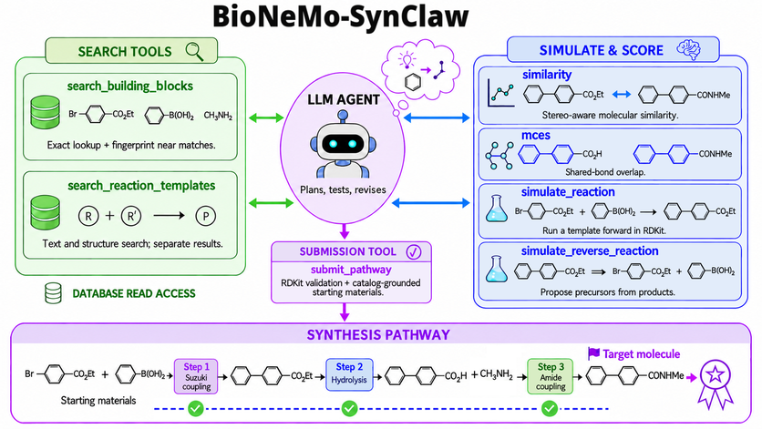

# BioNeMo-SynClaw

<picture>
  <source media="(min-resolution: 2dppx)" srcset="assets/BioNeMo-SynClaw@2x.png">
  
</picture>

BioNeMo-SynClaw is a harness that lets LLMs plan chemical synthesis routes with tool use. Given a target
molecule (a SMILES string), a model searches purchasable building blocks and reaction templates,
tests reaction steps with RDKit, and submits a route. BioNeMo-SynClaw validates the route, records the full
trace, and scores the result against the target.

It is useful for benchmarking models on retrosynthesis-style planning, for producing verified
tool-use trajectories, and, through the [MCP server](#mcp-server), for giving your own agent the
same chemistry tools.

## Contents

- [Requirements](#requirements) and [How it works](#how-it-works)
- [Quick Start](#quick-start): install, build a database, run a model
- [Reaction Templates](#reaction-templates) and [Building-Block Catalogs](#building-block-catalogs)
- [Task Sets](#task-sets) and [Generating Targets](#generating-targets)
- [Local Tools](#local-tools), [Hosted Model Runs](#hosted-model-runs), [MCP Server](#mcp-server)
- [Results And Reports](#results-and-reports) and [Dangerous-Molecule Screen](#dangerous-molecule-screen)
- [Development Checks](#development-checks)

## Requirements

- Python 3.11–3.14 and [uv](https://docs.astral.sh/uv/). RDKit is installed as a dependency.
- A building-block catalog. BioNeMo-SynClaw does not ship one: [Quick Start](#quick-start) shows how to
  try the tools with the bundled 37 common reagents, and how to prepare the eMolecules catalog
  for real runs.
- For hosted-model runs, an API key for your provider (see [Hosted endpoints](#hosted-endpoints)).
  The local tools and the MCP server need no key.

`synclaw download-public-data` and `synclaw prepare-emolecules-bbs` download third-party datasets that are not distributed with BioNeMo-SynClaw; running them is optional. For each dataset you choose to use, you are responsible for checking that its license fits your intended purpose.

## How it works

The agent loop is driven either by the hosted-model runner or by your own MCP client. Each run
writes a JSONL trace, which is evaluated into a summary CSV and can be combined across runs.

The harness is intentionally strict about final answers:

- A route must be submitted through `submit_pathway`.
- A submission must contain at least one reaction step, or `steps: []` plus one valid `building_block` for direct purchase.
- Each step names a reaction template and reactants.
- `BB:<id>` references are resolved against the building-block database.
- `INT:<step_number>` references resolve earlier intermediates.
- Raw reactant SMILES in final submissions must exactly match a building block in the database. Exploration tools may simulate arbitrary SMILES, but `submit_pathway` rejects ungrounded starting materials.
- The claimed product for each step must be generated by RDKit from the selected template.
- Invalid or malformed model tool calls are returned as structured, retryable tool errors so the model can repair them.

## Quick Start

BioNeMo-SynClaw is run from a checkout of this repository. Install the dependencies:

```bash
uv sync
```

Optional extras are `--extra mcp` for the [MCP server](#mcp-server) and `--extra dev` for tests
and linting.

### 1. Create a database

BioNeMo-SynClaw keeps building blocks and reaction templates in one SQLite file, `var/synclaw.sqlite` by
default. The bundled templates (501 reactions, see [Reaction Templates](#reaction-templates))
need no download:

```bash
uv run synclaw db init --db var/synclaw.sqlite
uv run synclaw ingest-reactions --db var/synclaw.sqlite
```

The database is disposable. After upgrading BioNeMo-SynClaw, rebuild it with these commands rather than
reusing it.

### 2. Add building blocks

**To try the tools quickly**, import the 37 common reagents bundled with the repository (listed
[below](#common-reagents)). This is enough to exercise the tools, not to plan realistic routes:

```bash
uv run synclaw ingest-bbs data/building_blocks/common_reagent_building_blocks.txt \
  --db var/synclaw.sqlite
uv run synclaw db prepare-search --db var/synclaw.sqlite
```

**For real runs**, prepare and import the eMolecules catalog, or import any file of one SMILES per
line with `ingest-bbs`. `--release` names a dated eMolecules release. See
[Building-Block Catalogs](#building-block-catalogs) for details:

```bash
uv run synclaw prepare-emolecules-bbs --release <YYYY-MM-DD>
uv run synclaw ingest-bbs \
  data/building_blocks/emolecules/emolecules_parent_<YYYY-MM-DD>.txt \
  --db var/synclaw.sqlite
uv run synclaw db prepare-search --db var/synclaw.sqlite
```

Run `synclaw db prepare-search` after the final building-block import, and again after any
building-block change. Search and model commands reject a missing or stale index and print the
command that rebuilds it. The prepared database holds the packed fingerprints that near search
scans, which each process loads into memory. Preparing in place ends with a `VACUUM` that needs
free disk about the database's size; `--output <path>` writes a compact copy instead.

Check the result:

```bash
uv run synclaw db stats --db var/synclaw.sqlite
uv run synclaw tool search-building-blocks 'CCO' --limit 5 --db var/synclaw.sqlite
```

### 3. Build a task set

Download the public ChEMBL target list and convert it into natural-language tasks (see
[Task Sets](#task-sets) for the options):

```bash
uv run synclaw download-public-data
uv run synclaw make-taskset data/synformer_test_sets/chembl_filtered_1k.txt \
  --dataset chembl --output artifacts/tasksets/chembl_llm_tasks.jsonl
```

### 4. Run a model

```bash
export NVIDIA_API_KEY=...   # or use --provider openai / anthropic / openrouter / custom
uv run synclaw run-model --model <model-id> \
  --taskset artifacts/tasksets/chembl_llm_tasks.jsonl --task-index 0 \
  --trace artifacts/traces/chembl_task0.jsonl \
  --summary-output artifacts/results/chembl_task0_summary.csv
```

To plan a single molecule without building a task set, pass `--smiles` instead of `--taskset` and
`--task-index`:

```bash
uv run synclaw run-model --model <model-id> --smiles 'CC(=O)Nc1ccc(O)cc1' \
  --trace artifacts/traces/one_molecule.jsonl
```

This writes a JSONL trace of every tool call and a one-row summary CSV. See
[Hosted Model Runs](#hosted-model-runs) for providers and run controls and
[Results And Reports](#results-and-reports) for scoring. To drive the tools from your own agent
instead, use the [MCP server](#mcp-server).

### Common reagents

Purchasable catalogs omit commodity reagents such as water, methyl iodide and acetic anhydride, so
templates that need them cannot be grounded. `data/building_blocks/common_reagent_building_blocks.txt`
supplies 37 of them as neutral forms (hydrazine for its hydrate, for example). Import it like any
building-block file, with `ingest-bbs` and then `db prepare-search`. It is opt-in, so compare
planning runs only across stocks built the same way.

## Reaction Templates

The bundled catalog is the union of four sources: SynFormer (114 templates), PaRoutes (176),
the Open Reaction Database (ORD, 203) and NVIDIA (`nvidia`, 8). It holds
**501 unique reactions**, and no SMARTS appears in more than one source. The `nvidia`
templates are generic ones written at NVIDIA. See the [catalog README](data/reaction_templates/README.md) for composition,
template IDs, attribution and the provenance recorded for each template.

`synclaw ingest-reactions --db var/synclaw.sqlite` installs the bundled catalog. It replaces each
bundled library in one transaction and leaves building blocks and search indexes alone. Model runs
and the MCP server refuse a database whose bundled libraries no longer match this version's
catalog, and print the command that fixes it. To use your own templates, run
`ingest-reactions <file> --library <name> [--annotations <file>]`, which replaces that library.

Every template in the database is available to the tools. To run with fewer sources, remove the
others, e.g. `synclaw db remove-reactions paroutes nvidia --db <path>` keeps SynFormer and ORD.

Each import renumbers every template in the database `R001` to `RN`, in an order set by a hash of
its SMARTS, so IDs carry no library name and neighbouring IDs come from mixed sources. The ID a
source file uses (e.g. `synformer:R044`) is kept in the template's metadata and never reaches the
model or MCP clients. IDs therefore belong to one database: importing or removing a library
renumbers them.

Each template is an executable reaction SMARTS plus the
natural-language fields the model searches: name, description, reaction family, search terms and
reactant roles. Bundled sources carry these inline; family descriptions come from
`data/reaction_templates/families.json`. Raw TXT imports get neutral names and are searchable
only by ID, SMARTS and molecule structure. JSONL, JSON and CSV imports can supply the full
annotations, for example:

```json
{
  "reaction_id": "amide-001",
  "name": "Amide formation",
  "family": "amide formation",
  "family_metadata": {
    "description": "Forms amides from amine and acyl-like partners.",
    "search_terms": ["amide formation", "amide coupling"]
  },
  "description": "Couple a carboxylic-acid-like reactant with an amine-like reactant to form an amide.",
  "smarts": "[C:1](=[O:2])[O:3].[N:4]>>[C:1](=[O:2])[N:4]",
  "search_terms": ["amide coupling", "carboxylic acid plus amine"],
  "search_exclusions": ["urea formation"],
  "reactant_roles": [
    {"position": 1, "role": "carboxylic acid or acyl-like reactant"},
    {"position": 2, "role": "amine-like reactant"}
  ]
}
```

A matching `search_terms` phrase boosts a template in text search and a matching
`search_exclusions` phrase penalizes it. Search reads annotations from the database, so reimport a
file after editing it. A library used in a model run must have family metadata for every family.

## Building-Block Catalogs

See the [Quick Start](#2-add-building-blocks) for instructions to create a building-block database.

`prepare-emolecules-bbs` downloads the eMolecules parent archive, validates and canonicalizes
each structure with RDKit (keeping isomeric SMILES), removes duplicates, and writes hashes and
rejected rows (`_invalid.tsv`) beside the output. Salts and other multi-component SMILES (about 1%
of a recent release) are reduced by default to their largest component by heavy atoms (`--multicomponent major`);
`--multicomponent keep` leaves them as shipped and `--multicomponent drop` removes them. The policy applies
before de-duplication, and changing it reconverts the release. Raw and derived files stay under the
git-ignored `data/building_blocks/`; do not commit or redistribute them. De-duplication holds every
canonical SMILES in memory, so preparation is CPU- and memory-hungry. Catalog size varies between
releases, and converting the same release twice gives the same `output_sha256`.

To check search latency on a much larger catalog before running rollouts, see
`scripts/benchmark_building_block_search.py --help`.

## Task Sets

Convert target SMILES into natural-language JSONL tasks:

```bash
uv run synclaw make-taskset data/synformer_test_sets/chembl_filtered_1k.txt \
  --dataset chembl \
  --output artifacts/tasksets/chembl_llm_tasks.jsonl
```

Each task contains:

- `target_smiles` and `canonical_target_smiles`
- a natural-language synthesis-planning prompt
- `excluded_tools` (empty by default) and the resulting `available_tools`
- any per-task budget overrides (see `--budget-set` below)
- `prompt_fingerprint`, which a run checks against its own prompt text

**Mixed tool sets.** A task's `excluded_tools` are hidden from the model and blocked at dispatch,
on top of any `--exclude-tool` on the run. Repeat `--tool-exclusion-set` to give each task one
set, drawn uniformly (seed with `--tool-exclusion-seed`, default 0); `none` is the full tool set.
The last set below leaves only `submit_pathway`:

```bash
uv run synclaw make-taskset data/synformer_test_sets/chembl_filtered_1k.txt \
  --dataset chembl \
  --output artifacts/tasksets/chembl_mixed_tools.jsonl \
  --tool-exclusion-set none \
  --tool-exclusion-set simulate_reverse_reaction,mces \
  --tool-exclusion-set search_building_blocks,search_reaction_templates,similarity,mces,simulate_reaction,simulate_reverse_reaction
```

**Per-task budgets.** A task may set its own `max_turns`, `max_tool_calls`, `max_model_len`,
`max_tokens` and `budget_feedback`, overriding the runner's. Budgets are positive integers
or `"inf"` (unlimited, and left out of the prompt); a task may lower `max_model_len` but not raise
it. Repeat `--budget-set` to give each task one set of overrides, drawn uniformly (seed with
`--budget-seed`); `none` keeps the runner's budgets:

```bash
uv run synclaw make-taskset data/synformer_test_sets/chembl_filtered_1k.txt \
  --dataset chembl \
  --output artifacts/tasksets/chembl_mixed_budgets.jsonl \
  --budget-set none \
  --budget-set max_turns=40,max_tool_calls=75,max_tokens=16384 \
  --budget-set max_model_len=131072,budget_feedback=false \
  --budget-set max_turns=inf,max_tool_calls=inf,max_model_len=inf,max_tokens=inf
```

Budget sets are drawn independently of tool sets. To pair a specific tool set with a budget, such
as a zero-shot subset with one tool call, generate those tasks separately with
`--tool-exclusion-set ... --budget-set max_tool_calls=1` and concatenate the files.

## Generating Targets

To build your own targets instead of using a published list, `generate-targets` runs reactions
forward over a reactant-template matrix: it picks a template, picks building blocks that fit its
reactant positions, runs the reaction through the same engine as `simulate_reaction`, and repeats
on the product. Every route therefore replays exactly through the tools an agent is given. That
makes the targets useful as training data: each comes with a known, executable route, so rollouts
can be scored against a target the model has not seen and routes can serve as reference solutions.

```bash
uv run synclaw generate-targets --matrix-dir <matrix-dir> \
  --output artifacts/targets/targets_100k.tsv \
  --count 100000
```

Build the matrix directory from this repository's templates and a building-block catalog, a file
headed `SMILES` (or `isosmiles`), optionally gzipped, whose first column is the SMILES:

```bash
uv run synclaw prepare-emolecules-bbs --release <YYYY-MM-DD>
uv run synclaw build-matrix \
  --building-blocks data/building_blocks/emolecules/emolecules_parent_<YYYY-MM-DD>.txt \
  --output var/reactant_template_matrix
```

`build-matrix` reads `data/reaction_templates/<library>/templates.jsonl` directly and tests every
block against every template's reactant queries; pass `--limit` for a pilot run on part of the
catalog. By default it drops salts and mixtures (`--multicomponent drop`), which match far more
reactant positions than the chemistry warrants, and entries whose SMILES carry atom map numbers
(`--atom-maps drop`), which would otherwise leak into atom-mapped targets. `meta.json` in the
output records how the matrix was built.

A matrix outlives the templates it was built from, so rebuild it after the template catalog changes.

### Feeding targets into `make-taskset`

`make-taskset` reads one SMILES per line, so generate with `--no-pathway`:

```bash
uv run synclaw generate-targets --matrix-dir <matrix-dir> \
  --output artifacts/targets/targets.txt --count 1000 --no-pathway \
  --mw-min 150 --mw-max 900
uv run synclaw make-taskset artifacts/targets/targets.txt \
  --dataset generated --output artifacts/tasksets/generated_llm_tasks.jsonl
```

Set the size bounds deliberately. Unfiltered output spans MW 18 to 3507, and a route whose last
step is a hydrolysis or elimination can end in water, methanol or acetic acid (about 0.5% of
targets). Those replay perfectly, so nothing rejects them, but "synthesize water" is a worthless
task. `--mw-min` and `--mw-max` are open by default because what counts as a worthwhile target
belongs to the benchmark, not the generator.

Do **not** feed the default two-column TSV to `make-taskset`. It will not error, but the prompt is
built from the raw line and hands the model the full route it was asked to find. Keep the pathway
column for verification and scoring, and generate a separate `--no-pathway` file (or `cut -f1`)
for task sets.

## Local Tools

Call the same tool handlers without MCP or an LLM:

```bash
uv run synclaw tool search-building-blocks 'CCO' --limit 5 \
  --db var/synclaw.sqlite

uv run synclaw tool search-reaction-templates 'amide formation' \
  --db var/synclaw.sqlite

uv run synclaw tool similarity \
  'CCOc1ccccc1' \
  'CCNc1ccccc1'

uv run synclaw tool mces \
  'CCOc1ccccc1' \
  'CCNc1ccccc1'

# R329 and R401 are SynFormer's R036 and R009 in a database holding all four bundled sources.
uv run synclaw tool simulate-reaction \
  --reaction-id R329 \
  --reactants-json '["Nc1nccc2occc12","N#CC1CC12CNC2"]' \
  --product-smiles 'N#CC1CC12CN(C(=O)Nc1nccc3occc13)C2' \
  --db var/synclaw.sqlite

uv run synclaw tool simulate-reverse-reaction \
  --reaction-id R401 \
  --product-smiles 'NC=O' \
  --db var/synclaw.sqlite

uv run synclaw tool submit-pathway \
  --target-smiles 'N#CC1CC12CN(C(=O)Nc1nccc3occc13)C2' \
  --steps-json '[{"reaction_id":"R329","reactants":["Nc1nccc2occc12","N#CC1CC12CNC2"],"product_smiles":"N#CC1CC12CN(C(=O)Nc1nccc3occc13)C2"}]' \
  --pathway-text 'Use the urea-forming template to couple the heteroaryl amine and bicyclic amine.' \
  --db var/synclaw.sqlite
```

- `search_building_blocks` takes a SMILES and returns the exact stock entry, if any, followed by
  near matches ranked by similarity (`--no-near` disables them, `--min-similarity` sets a floor).
  Each result has a `submit_reference` such as `BB:123`.
- `search_reaction_templates` takes a text query, reactant and/or product SMILES, or both. With no
  arguments it returns an overview of the selected reaction families.
- `similarity` returns the Tanimoto similarity of two molecules' Morgan fingerprints, stereo-aware
  with a constitutional score alongside.
- `mces` returns the maximum common edge subgraph of two molecules (RDKit RASCAL), with a 20-second
  timeout per pair.
- `simulate_reaction` is the permissive scratch pad: it accepts raw SMILES, and with
  `product_smiles` it checks the claim against the products RDKit generates.
  `simulate_reverse_reaction` runs a template backwards from a product and returns candidate
  precursor sets with their stock grounding; unmatched precursors may still be valid intermediates.
- `submit_pathway` is strict, as described in [How it works](#how-it-works). The final product is
  computed by RDKit from the last step, never supplied by the model, and a step's `reaction_id` may
  also be a reaction SMARTS that must itself generate the claimed product.

The full tool descriptions the model sees are in `src/synclaw/tools/contracts.py`.

## Hosted Model Runs

`run-model` runs one task through a hosted model and the local tool harness. It writes a JSONL
trace and, with `--summary-output`, a one-row evaluated summary CSV. The Quick Start shows a
minimal run; a fuller one:

```bash
uv run synclaw run-model \
  --provider nvbuild \
  --model <model-id> \
  --taskset artifacts/tasksets/chembl_llm_tasks.jsonl \
  --task-index 0 \
  --trace artifacts/traces/chembl_task0.jsonl \
  --summary-output artifacts/results/chembl_task0_summary.csv \
  --max-turns 80 \
  --max-tool-calls 150 \
  --max-tokens 32768 \
  --stop-condition exact
```

Run `synclaw run-model --help` for every option, including sampling, retries, checkpoints and
context warnings. A task's own budgets override the matching options below.

| Option | Use |
| --- | --- |
| `--max-turns` | Assistant-turn budget, default 80. The model is warned with 3 turns left and prompted to submit on the last. |
| `--max-tool-calls` | Soft tool-call budget, default 150. When reached, the next turn is prompted to call `submit_pathway`, then the harness falls back to the best accepted route. |
| `--max-tokens`, `--max-model-len` | Per-response output cap (default 32768) and context limit. Both are stated in the system prompt, and each response's output is clipped to the context left. Without `--max-model-len`, no clipping happens. |
| `--stop-condition` | What ends a rollout. `exact` (default): an accepted submission whose product is the target under exact-match identity (see Results And Reports). A number from `0.0` to `1.0`: an accepted submission at or above that similarity, or an identity match (`0.0` ends on any accepted route). Below the condition the harness coaches the model to improve. `model`: the model's reply without a tool call ends the run with its best accepted route, with no coaching. |
| `--no-budget-feedback` | Disables progress messages (see [Budget feedback](#budget-feedback)). The system prompt still states the limits and enforcement is unchanged. |
| `--reasoning-effort` | Optional `low`, `medium`, `high`, `xhigh` or `max` hint, sent only when set. Leave unset unless the model supports it. |
| `--hide-target-building-block` | Treats the target as out of stock, to benchmark exact-match synthesis without the shortcut of buying it. Every building block scored as the target, including its tautomers and isomers of stereo it leaves open, is hidden from search, reverse-step grounding and submission. The model is not told. Other analogues, including stereoisomers that conflict with stereo the target specifies, can still be bought and are scored by similarity. |
| `--hide-building-block-id ID` | Hides a catalog BB ID the same way. Repeatable, combines with target hiding, and IDs must exist in the database. |
| `--hide-building-block-similarity CUTOFF` | Also hides every stock entry whose constitutional Morgan/Tanimoto similarity to the target is at or above the cutoff (0 to 1). Implies target hiding. |
| `--request-timeout` | Seconds to wait for each model response, default 120. Reasoning models with a large output cap can need far longer. A timed-out request is retried up to `--retries` times (default 3); after that the run ends with a `run_error` event, which the trace report shows under Summary. Pass `--checkpoint PATH` to keep a checkpoint to resume from. |
| `--summary-output` | Writes an evaluated CSV row after the run. |

The trace records hidden building-block IDs, and summaries report `target_hidden_from_stock` and
`hidden_building_block_ids`. Resuming from a checkpoint requires the same hiding options.

### Budget feedback

Before each response the model gets an advisory reminder of its remaining turns, tool calls and
estimated context (a leading `~` marks an estimate), attached to the current user input or last
tool result rather than as an extra turn. Pass `--no-budget-feedback` to disable these
reminders; the limits and their enforcement are unchanged.

- At 50% of context remaining the model is asked to submit its best verified route, even an
  analogue. At 25% it is told to submit now.
- With a known context limit, each response's output cap is the smaller of `--max-tokens` and the
  estimated context left, less a safety margin. If nothing fits, the run ends as
  `context_window_exceeded` with its best accepted pathway; history is never truncated.
- A response cut off by the output limit gets one recovery attempt per run. A second ends the run.
- Once a valid pathway is accepted, the model may end the run with `<FINISH>` if it cannot improve
  the route. The run keeps the best accepted pathway, and validation is not bypassed.

### Hosted endpoints

`--model` is passed to the endpoint verbatim. A provider preset supplies the API style, endpoint
and credential variable. Presets live in `src/synclaw/providers.json`, so a deployment can ship a
different table without code changes.

| Provider | API style | Endpoint | Key env | Notes |
| --- | --- | --- | --- | --- |
| `nvbuild` | Chat Completions | `https://integrate.api.nvidia.com/v1` | `NVIDIA_API_KEY` or `NVBUILD_API_KEY` | Default. Models hosted on build.nvidia.com. |
| `openai` | Responses | `https://api.openai.com/v1/responses` | `OPENAI_API_KEY` | Uses `previous_response_id` continuations by default. `--api-mode chat` uses `https://api.openai.com/v1`. |
| `anthropic` | Messages | `https://api.anthropic.com/v1/messages` | `ANTHROPIC_API_KEY` | Sends `x-api-key` and `anthropic-version: 2023-06-01`. |
| `openrouter` | Chat Completions | `https://openrouter.ai/api/v1` | `OPENROUTER_API_KEY` | Provider-reported `cost` in usage is carried into traces and summaries. |
| `custom` | Chat Completions | none | `--api-key-env`, optional | Any other endpoint. Pass `--base-url`, or `--api-mode responses --responses-url URL`, or `--api-mode messages --messages-url URL`. Without `--api-key-env` no key is sent, for unauthenticated local servers. |

Flags override every preset field: `--api-mode`, `--base-url`, `--responses-url`,
`--messages-url`, `--api-key-env` (when an endpoint flag replaces the preset's URL, the preset's
key variables are not read, so pass this if the new endpoint needs a key), `--auth-header`
(`bearer` or `x-api-key`) and `--responses-state-mode` (`full` resends the whole history each
turn, for endpoints that do not store responses). A run fails before any request if the selected
API has no endpoint or a named key variable is unset. BioNeMo-SynClaw records token usage reported by the
endpoint; it does not estimate prices.

```bash
# Each takes the same --taskset, --task-index, --db and --trace flags as above.
uv run synclaw run-model --provider openai --model <model-id> ...
uv run synclaw run-model --provider anthropic --model <model-id> --reasoning-effort high ...
uv run synclaw run-model --provider openrouter --model <org>/<model-id> ...
uv run synclaw run-model --provider custom --model <model-id> --base-url http://localhost:8000/v1 ...
```

## MCP Server

Install the MCP extra, then run:

```bash
uv sync --extra mcp
uv run synclaw mcp serve --db var/synclaw.sqlite
```

The server is named `bionemo-synclaw-server` and exposes `search_building_blocks`,
`search_reaction_templates`, `similarity`, `mces`, `simulate_reaction`, `simulate_reverse_reaction`
and `submit_pathway`. Use MCP when another agent or client owns the model loop. Use `run-model` when this
package should own the hosted-model loop and write traces and results directly.

## Results And Reports

Evaluate a trace, combine result CSVs, and render a trace as Markdown:

```bash
uv run synclaw eval-trace artifacts/traces/run_001.jsonl \
  --model <model-id> \
  --prompt-version prompt-or-harness-label \
  --output artifacts/results/run_001_summary.csv \
  --db var/synclaw.sqlite

uv run synclaw combine-results 'artifacts/results/*_summary.csv' \
  --output artifacts/results/model_run_summaries.csv

uv run python scripts/render_tool_trace.py artifacts/traces/chembl_task0.jsonl \
  --model <model-id> \
  --title 'ChEMBL Task 0 Tool Trace' \
  --output artifacts/reports/chembl_task0.md
```

The evaluator scores the best accepted `submit_pathway` result in a trace (the last attempt if none
was accepted). Summary columns cover whether a submission was accepted, reaction-valid and
building-block-grounded; `similarity_to_target` (stereo-aware) with
`constitutional_similarity_to_target` alongside; turn, tool-call and failure counts; and the hidden-stock
fields.

`run_success` means the run produced an accepted, RDKit-validated pathway. `meets_similarity_floor`
records whether that product also met the `--stop-condition` (`model` scores like `exact`).
Identity is judged by full Standard InChI, which preserves stereochemistry and isotopes and
normalizes supported tautomers and some charge representations, with two relaxations. Where the
target leaves a stereocentre or double bond unspecified, a product that specifies it still matches;
a product that leaves open stereo the target specifies does not. Tautomers that Standard InChI keeps
apart, such as keto-enol forms, match after RDKit tautomer canonicalization that keeps stereo, unless
the product is the target's own tautomer with different stereo. Count exact reconstructions using
`accepted` and `identical_to_target`, not fingerprint similarity. To ignore isotope labels, pass
targets through `synclaw.core.chem.strip_isotopes` before making tasks.

## Dangerous-Molecule Screen

BioNeMo-SynClaw offers an **opt-in** watchlist screen based on [ReaSyn](https://github.com/NVIDIA-BioNeMo/ReaSyn).
A molecule is flagged when its Morgan/Tanimoto similarity to an entry in `mols_to_filter.txt`
exceeds 0.8, comparing each SMILES as a whole. BioNeMo-SynClaw uses 2,048-bit fingerprints where ReaSyn
uses 4,096, so results near the cutoff can differ. This is a watchlist filter, not a general
toxicity predictor or a claim of regulatory compliance.

It is **off by default**. To enable it, fetch the watchlist with
`uv run synclaw download-public-data --name reasyn-mols-to-filter` (it lands in the ignored
`var/safety/`) and pass `--toxicity-screen on`. An enabled screen raises an error if the watchlist
is missing or has no valid molecules. When enabled:

- A flagged **target** is refused before planning: `run-model` spends no tool call or model request
  on it. MCP itself is targetless.
- `submit_pathway` screens the generated products of each route step, including alternatives,
  intermediates and the final product, or the purchased product for a zero-step route. Starting
  reactants, search results and exploratory simulations are not screened.
- `submit_pathway` results carry a `toxicity_screen` block. Traces record `target_screened` or
  `target_refused`, and summaries gain `toxicity_screen`, `toxicity_screened_count`,
  `toxicity_refused_count` and `toxicity_refused_smiles`.

Configure it with `--toxicity-screen {on,off}` and `--toxicity-watchlist PATH` on `run-model`,
`mcp serve` and `tool submit-pathway`, or with `SYNCLAW_TOXICITY_SCREEN`,
`SYNCLAW_TOXICITY_WATCHLIST` and `SYNCLAW_TOXICITY_THRESHOLD`. A watchlist path alone does not
enable screening. `eval-trace` scores recorded submissions without re-screening them.

## Development Checks

```bash
uv run --extra mcp --extra dev pytest
uv run --extra dev ruff check .
```

The tests use temporary fixture databases and require RDKit.

## Contributing

Contributions require a DCO sign-off (`git commit -s`); see [CONTRIBUTING.md](CONTRIBUTING.md).

## License

BioNeMo-SynClaw is licensed under the [Apache License 2.0](LICENSE), except the reaction
templates in `data/reaction_templates/ord/`, which are licensed under
[CC BY-SA 4.0](data/reaction_templates/ord/LICENSE). Third-party data in this
repository, including the reaction-template sources under `data/reaction_templates/`,
and third-party dependencies are listed in [THIRD_PARTY_NOTICES.md](THIRD_PARTY_NOTICES.md).
